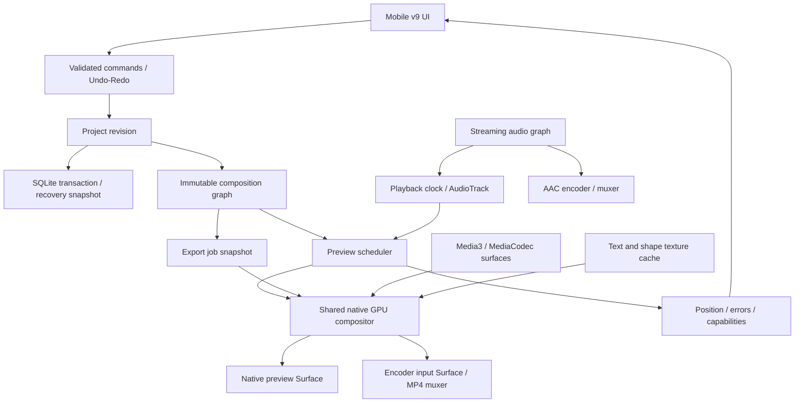

# معماری ویرایشگر اندروید — مرحلهٔ ۰

تاریخ: ۲۰۲۶-۱۱-۰۶  
محدوده: اپلیکیشن مستقل اندروید؛ بدون تغییر نصب‌کنندهٔ ویندوز یا پلاگین‌های Adobe/Resolve.  
خط مبنا: `676e2c1`، نسخهٔ `0.5.0-ui63`.  
وضعیت: طراحی تکمیل و با اختیار واگذارشده توسط کاربر، از نظر تصمیم معماری تأیید شد. این تأیید، تأیید اجرای موتور پیشنهادی، عملکرد گوشی یا تکمیل فازهای ۱ تا ۴ نیست. در مرحلهٔ ۰ فقط مستندات نوشته می‌شوند.

## ۱. تصمیم محصول و مرز تعهد

هدف، تدوینگر چندلایه با تجربهٔ کاربری هم‌ردهٔ ابزارهای موبایل حرفه‌ای و تمرکز ویژه بر کپشن فارسی، موشن و جدول است. «در سطح CapCut» هدف توسعه است؛ ادعای برابری امکانات یا عملکرد نسخهٔ فعلی نیست. ظاهر، رسانه، قالب و کد اختصاصی CapCut کپی نمی‌شوند.

اندروید اولویت دارد. حداقل نسخه فعلاً Android 10 / API 29، دستگاه اصلی ارزیابی Honor 90 و خروجی پایه SDR، MP4، H.264/AAC، 1080p/30fps است. نسخهٔ اندروید Honor 90 هنوز ثبت نشده است. iOS، نسخهٔ دسکتاپ مستقل، HDR و خروجی حرفه‌ای کدک‌های دیگر در دامنهٔ این چهار فاز نیستند و در TODO دلیل دارند.

تصمیم‌های مهم را مدیر فنی می‌گیرد. هر تغییر معماری، علت و آزمون پذیرش می‌خواهد. تکمیل فاز فقط با شواهد اجرای همان خروجی اعلام می‌شود. دسترسی نداشتن به گوشی، مدل یا سرویس با «تست گذشت» جایگزین نمی‌شود.

## ۲. وضعیت واقعی امروز

| بخش | موجود و بررسی‌شده | فاصله تا هدف |
| --- | --- | --- |
| رابط | طرح موبایل v9، خانه، تدوین، سرور، فارسی/انگلیسی، تم روشن/تیره | ارگونومی لمسی و حالت افقی به آزمون دستگاه نیاز دارند |
| پلیر | Media3 ExoPlayer 1.5.1 و MediaCodec؛ MP4، تصویر واقعی، seek/play/pause در شبیه‌ساز | انتقال snapshot از TextureView با JPEG/PNG و Base64 به Canvas وب گلوگاه چندلایه است |
| تایم‌لاین | کلیپ، لایه، برش، انتخاب، قفل، snap، تکثیر، Undo/Redo پایه | آزمون فشار، قرارداد فرمان جامع و زمان‌بندی بومی لازم است |
| رندر | Canvas مشترک برای متن، جدول، شیپ، کی‌فریم و بخشی از افکت‌ها | موتور GPU مشترک پیش‌نمایش/خروجی هنوز وجود ندارد |
| خروجی | MP4 بومی H.264/AAC و WebM مرورگر | فریم‌خوانی CPU، محدودیت فعلی ۱۸۰ ثانیه/1080p/30fps، متادیتای BT.601 در VideoEncoder فعلی و میکس صوت با حافظهٔ متناسب با مدت |
| پروژه | فایل `.varna` نسخهٔ ۱ با ساعت صحیح 720000 تیک/ثانیه؛ autosave و بازیابی پایه | رابط داخلی هنوز زمان اعشاری دارد؛ ذخیرهٔ چندپروژه‌ای و دارایی پایدار لازم است |
| متن | کپشن، استایل کلمه‌ای، SRT، فرهنگ محلی و بررسی آفلاین مستقل | زمان‌بندی دقیق کلمات و پیش‌نمایش/خروجی بومی فارسی باید اعتبارسنجی شوند |
| گفتار | JNI مربوط به whisper.cpp v1.8.3؛ ورود/دانلود مدل اختیاری | استنتاج و دقت فارسی مدل روی دستگاه تأیید نشده؛ توزیع یکنواخت زمان کلمات، alignment واقعی نیست |
| سرور | اتصال انتخابی به رایانهٔ شخصی و تشخیص قابلیت | سرور مرکزی پیکربندی نشده؛ هیچ انتقال خودکار رسانه مجاز نیست |

آزمون‌های موجود در `mobile56/tests` و `native59/tests` دارایی قابل استفاده‌اند؛ گذشتن آن‌ها به معنی آماده‌بودن معماری هدف نیست. گزارش جزئی خط مبنا در `mobile56/docs/UI63.md` است.

## ۳. استک منتخب و جایگزین‌ها

| لایه | انتخاب | دلیل و جایگزین |
| --- | --- | --- |
| رابط | حفظ v9 با HTML/CSS و WebView محلی؛ ماژول‌های جدید UI و مدل با TypeScript | حفظ طراحی تأییدشده و جلوگیری از بازنویسی بی‌دلیل. React در صورت نیاز واقعی به مدیریت UI قابل ارزیابی است، ولی پیش‌نیاز موتور نیست |
| لایهٔ اندروید | حفظ Java فعلی و تفکیک کلاس‌ها؛ Android SDK و AndroidX | کتابخانه‌های فعلی قابل ساخت و تست هستند. Kotlin/Compose جایگزین معتبر رابط کاملاً بومی است؛ مهاجرت عمومی زبان اکنون ارزش کافی ندارد |
| دیکد | Media3/MediaCodec، خروجی Surface برای تصویر | رمزگشایی سخت‌افزاری و گزارش خطای واقعی. مبنا 1.5.1 قفل‌شده است؛ ارتقای نسخه فقط بعد از سازگاری و رگرسیون، بدون وابستگی به API آزمایشی تأییدنشده |
| ترکیب تصویر | compositor بومی OpenGL ES 3.0 روی EGL؛ یک Composition Graph | بافت ویدیو مستقیماً وارد GPU شود. SurfaceTexture و encoder input Surface؛ خروجی encode نیازمند رفت‌وبرگشت Base64 نباشد |
| متن و شیپ | Android Canvas/StaticLayout برای ماسک/بافت، ترکیب و انیمیشن در GPU | از شکل‌دهی و BiDi سیستم برای فارسی استفاده می‌کند. Skia/HarfBuzz اختصاصی فقط در صورت اثبات نارسایی؛ افزودن مستقیم آن‌ها در نسخهٔ اول لازم نیست |
| صدا | decode با MediaCodec، میکسر PCM جریانی 48kHz، پخش AudioTrack، encode با AAC | یک ساعت و یک سیاست میکس؛ مصرف حافظه مستقل از طول پروژه. Oboe/C++ برای تأخیر بسیار پایین جایگزین آینده است |
| خروجی | MediaCodec + MediaMuxer، H.264/AAC به MP4 | قابلیت بومی و بدون FFmpeg حجیم برای مسیر پایه؛ پروفایل‌ها با توان واقعی encoder محدود می‌شوند |
| رسانهٔ ناسازگار | تشخیص و خطای قابل اقدام؛ تبدیل انتخابی روی سرور شخصی موجود | FFmpeg فقط به شکل ماژول محدود و با build/مجوز قفل‌شده در صورت نیاز اثبات‌شده افزوده می‌شود؛ وابستگی اجباری MVP نیست |
| ذخیره | SQLite اندروید برای کاتالوگ/تراکنش؛ فایل پروژه JSON و رسانهٔ app-private | چند پروژه، بازیابی و پاک‌سازی قابل کنترل؛ JSON سند قابل انتقال، SQLite منبع کاتالوگ است |
| هوش مصنوعی | whisper.cpp موجود؛ ماژول segmentation با مدل محلی ONNX/TFLite پس از ارزیابی | دانلود/ورود مدل با انتخاب کاربر؛ حالت محلی و سرور شخصی جدا. مدل حذف پس‌زمینه هنوز انتخاب/بنچمارک نشده است |
| تست | آزمون مدل با ابزار Node موجود؛ Playwright برای UI؛ JUnit/آزمون دستگاه برای موتور | مسیرهای واقعی رسانه و خطا آزموده شوند؛ bridge شبیه‌سازی‌شده جای تست Android نیست |
| ساخت | حفظ build پایتون قفل‌شده تا راه‌اندازی Gradle Wrapper و CI اندروید | ابزار انتشار موجود شکسته نمی‌شود؛ خروجی Gradle ابتدا باید از نظر وابستگی، ABI، امضا و رفتار با مسیر موجود تطبیق داده شود |

Tauri/Electron موتور اصلی این اپ اندروید نیستند. Electron گزینهٔ دسکتاپ است؛ Tauri موبایل و Flutter نیز می‌توانند پوسته باشند، اما گلوگاه snapshot را خودشان حل نمی‌کنند. Rust/wgpu، MLT و GStreamer هم‌زمان اضافه نمی‌شوند: هرکدام هزینهٔ binding، بسته‌بندی و renderer جدید دارند. در این چهار فاز یک موتور بومی اندروید اولویت دارد، با قراردادهای مستقل از UI برای توسعهٔ بعدی.

## ۴. ماژول‌ها و مسئولیت‌ها

| ماژول | مالکیت داده و کار | خروجی و قرارداد |
| --- | --- | --- |
| Timeline | ترک، کلیپ، اتصال رسانه، trim/split/move، snap، انتخاب و قفل | فرمان معتبر و snapshot زمان‌بندی؛ بدون کنترل مستقیم decoder |
| Player | ماشین حالت idle/preparing/ready/playing/seeking/buffering/error؛ foreground/background | وضعیت و timestamp واقعی، نه پیشرفت ساختگی |
| Composition | تبدیل سند معتبر به گراف رندر و ترتیب لایه‌ها | snapshot تغییرناپذیر با revision و manifest قابلیت‌ها |
| Rendering/Effects | دیکد تصویر به texture، transform، crop، blend، mask و shader | یک مسیر ارزیابی فریم برای preview و export |
| Audio | decode، resample، gain، fade، mixing و ساعت پخش | PCM جریانی و position؛ صدای ویدیو یک بار وارد میکس می‌شود |
| Text/Subtitle | جمله، کلمه، سبک، RTL/BiDi، ماسک متن و ورود/خروج | بافت‌های cacheشده بر اساس متن/فونت/سبک؛ زمان‌بندی مستقل از UI |
| Text Review | فرهنگ شخصی، پیشنهاد، اصلاح قدیمی، اصلاح آفلاین مستقل | پیشنهاد با بازهٔ متن و revision؛ اعمال با تأیید و قابل Undo |
| Export | snapshot ثابت، تنظیمات معتبر، encoding/muxing، لغو و اشتراک | Job ID، تعداد فریم واقعی/کل، elapsed، مرحله و خطای مشخص |
| Project/Storage | schema، migration، کاتالوگ، autosave، دارایی و relink | تراکنش و فایل معتبر؛ پاک‌سازی با شمارش مراجع و حفظ Undo |
| Undo/Redo | اجرا/معکوس فرمان، گروه‌بندی gesture و transaction | تغییر اتمیک سند و revision؛ هیچ تغییر سند از UI خارج این مسیر نباشد |
| Jobs/AI | صف محدود، cancellation، مدل محلی و اتصال انتخابی سرور | وضعیت واقعی queued/running/cancelling/completed/failed |
| Platform Bridge | قرارداد allowlist بین WebView و موتور | پیام با requestId/revision/session و خطاهای نوع‌دار؛ بدون ارسال فریم تصویری |

### قراردادهای مشترک

فرمان شامل `commandId`، `projectId`، `expectedRevision`، نوع و پارامتر است. تغییرات قدیمی یا ناسازگار رد می‌شوند. پاسخ پیش‌نمایش قدیمی حق بازنویسی فریم جدید ندارد. فرمان حذف/trim روی ترک قفل‌شده رد می‌شود. حرکت ممتد دسته یا اسلایدر یک عملیات Undo است. هر ویژگی در manifest قابلیت‌ها باید مشخص کند در preview، export و سخت‌افزار دستگاه پشتیبانی می‌شود یا خیر.

اصلاح متن قدیمی حذف نمی‌شود. بررسی آفلاین کنار ویرایش متن و دارای سوییچ مستقل است؛ هنگام یافتن پیشنهاد، وضعیت بصری و شمارنده دارد. پیشنهاد با تأیید کاربر اعمال می‌شود. قبول/رد و «اعمال به مشابه‌ها» فرمان قابل Undo است. فرهنگ شخصی و اصلاح‌های تأییدشده محلی می‌مانند. تبدیل فینگلیش خودکار و بدون تأیید انجام نمی‌شود.

## ۵. ساختار پوشه‌ها و مهاجرت تدریجی

این ساختار هدف است؛ پوشه‌های پیشنهادی با نوشتن این سند ایجاد یا اجرا نشده‌اند.

```text
ARCHITECTURE.md
TODO.md
mobile56/
  web/                         # Existing v9 UI and compatibility adapters
  src/
    app/                       # Navigation, sessions, capabilities, localization
    timeline/                  # View models and touch interactions
    inspector/                 # Contextual controls
    domain/                    # Types, commands, validation, migration
    bridge/                    # Typed native protocol; no video frames
  android/
    src/com/varnalabs/mobile/
      MainActivity.java        # Existing shell, reduced to lifecycle wiring
      bridge/
      media/                   # Probe, decode, URI import, capability checks
      playback/                # Scheduler and playback state
      render/                  # EGL, surfaces, graph nodes, shaders, text cache
      audio/                   # Streaming decode, mix, output and encoding
      export/                  # Jobs, codec, muxer and final publication
      storage/                 # SQLite catalog, snapshots and asset references
      ai/                      # Local model lifecycle and background tasks
  schemas/                     # Project v2 and bridge message contracts
  assets/                      # Licensed fonts, templates, stickers and shaders
  tools/                       # Existing reproducible bundle/build utilities
  tests/
    domain/
    browser/
    fixtures/
    rendering/
    compatibility/
    benchmarks/
native59/                      # Existing pinned libraries, source locks and JNI
  tests/                       # Existing Android smoke tests retained
```

UI63 ادامهٔ کار می‌ماند. ماژول جدید پشت adapter جایگزین رفتار موجود می‌شود، نه با جابه‌جایی یک‌بارهٔ تمام فایل‌ها. فرمت قدیمی باید پیش از تغییر قابل خواندن بماند. قابلیت‌های سالمِ فازهای بالاتر که امروز وجود دارند حذف نمی‌شوند؛ فقط دوباره مطابق معیار پذیرش سنجیده خواهند شد.

## ۶. مدل دادهٔ پروژه

فرمت فعلی `.varna` نسخهٔ ۱ حفظ و با migration صریح به نسخهٔ ۲ خوانده می‌شود. نسخهٔ جدید JSON مستقل از UI است. migration فایل اصلی را بازنویسی نمی‌کند مگر با ذخیرهٔ صریح یا ایجاد نسخهٔ بازیابی. parser فعلی هنوز نسخهٔ ۲ زیر را قبول نمی‌کند؛ این نمونه قرارداد طراحی است، نه فایل قابل ورود در اپ امروز.

واحد زمان، تیک صحیح با timebase برابر `1/720000` ثانیه است. زمان پروژه، رسانه، انیمیشن و صوت جدا تعریف می‌شوند. بازه‌ها نیمه‌باز `[start, end)` هستند. نرخ فریم rational است؛ مثلاً `30000/1001` برابر 24024 تیک برای هر فریم است. صوت داخلی 48000Hz، هر نمونه ۱۵ تیک است. تبدیل به microsecond فقط در مرز API بومی با کنترل گردکردن انجام می‌شود.

```json
{
  "format": "varna-project",
  "version": 2,
  "timebase": { "numerator": 1, "denominator": 720000 },
  "project": {
    "id": "project-001",
    "name": "My edit",
    "revision": 12,
    "width": 1080,
    "height": 1920,
    "frameRate": { "numerator": 30, "denominator": 1 },
    "durationTicks": 7200000,
    "color": { "primaries": "bt709", "transfer": "bt709", "range": "limited" },
    "background": "#000000"
  },
  "assets": [
    {
      "id": "asset-video-001",
      "kind": "video",
      "mediaRef": "media/asset-video-001",
      "name": "input.mp4",
      "bytes": 12000000,
      "fingerprint": { "algorithm": "sha256", "value": null },
      "durationTicks": 14400000,
      "rotationDegrees": 0,
      "pixelAspectRatio": { "numerator": 1, "denominator": 1 },
      "proxyRef": null
    }
  ],
  "tracks": [
    { "id": "track-video-1", "kind": "video", "order": 0, "locked": false, "muted": false },
    { "id": "track-audio-1", "kind": "audio", "order": 0, "locked": false, "muted": false }
  ],
  "clips": [
    {
      "id": "clip-video-1",
      "trackId": "track-video-1",
      "assetId": "asset-video-001",
      "startTicks": 0,
      "durationTicks": 7200000,
      "sourceInTicks": 0,
      "playbackRate": { "numerator": 1, "denominator": 1 },
      "linkedGroupId": "linked-001",
      "transform": { "x": 0.5, "y": 0.5, "scaleX": 1, "scaleY": 1, "rotation": 0, "anchorX": 0.5, "anchorY": 0.5 },
      "effects": [],
      "keyframes": []
    },
    {
      "id": "clip-audio-1",
      "trackId": "track-audio-1",
      "assetId": "asset-video-001",
      "startTicks": 0,
      "durationTicks": 7200000,
      "sourceInTicks": 0,
      "playbackRate": { "numerator": 1, "denominator": 1 },
      "linkedGroupId": "linked-001",
      "gain": 1,
      "fadeInTicks": 0,
      "fadeOutTicks": 0,
      "effects": [],
      "keyframes": []
    }
  ],
  "layers": [],
  "captions": [],
  "transitions": [],
  "export": { "container": "mp4", "videoCodec": "h264", "audioCodec": "aac", "audioSampleRate": 48000 }
}
```

در مثال، `fingerprint.value: null` یعنی محاسبه نشده، نه اعتبارسنجی موفق. رسانهٔ اصلی و proxy مراجع جدا دارند. مسیرهای قابل انتقال نسبی‌اند؛ مسیر آزاد به حافظهٔ سیستم پذیرفته نمی‌شود. زیرنویس شامل متن اصلی، زبان، جهت، منبع زمان‌بندی، بازه و استایل هر کلمه است. اثر و keyframe شامل نوع/نسخه و پارامتر معتبر هستند. glyph یا state decoder در سند ذخیره نمی‌شود. فونت با شناسهٔ asset و fallback مشخص نگه‌داری می‌شود.

اعتبارسنجی باید شناسه‌های یکتا، مراجع موجود، حدود عددی، عمق/اندازهٔ ورودی، بازه‌ها، پشتیبانی effect، مسیر امن و سازگاری زمان منبع با سرعت را بررسی کند. نسخهٔ جدیدتر ناشناخته با پیام روشن باز نمی‌شود؛ ویژگی ناشناخته بی‌صدا حذف نمی‌شود.

## ۷. جریان داده، رندر و ساعت



رابط، کنترل‌ها را نشان می‌دهد؛ decoder، readback تصویر و میکس روی thread رابط انجام نمی‌شوند. سطح preview بومی در محل قاب UI قرار می‌گیرد؛ جای آن با تغییر چرخش/اندازه/بازشدن پنل به‌روز می‌شود. اگر WebView روی Surface قرار بگیرد، ترتیب لایه و لمس باید در آزمون renderer اولیه اثبات شود. Canvas وب تا عبور رندر بومی از آزمون برابری، مسیر سازگاری و مرجع تصویری است؛ دو مسیرِ بی‌برچسب با خروجی متفاوت منتشر نمی‌شوند.

پیش‌نمایش دارای صوت از ساعت ارائهٔ AudioTrack پیروی می‌کند. در پروژهٔ بی‌صدا، ساعت monotonic همان قرارداد را اجرا می‌کند. برای هر ویدیو زمان منبع از زمان پروژه و نگاشت سرعت محاسبه می‌شود. frame queue محدود است؛ فریم قدیمی در preview قابل حذف است، ولی فریم خروجی هرگز حذف نمی‌شود. seek فقط آخرین مقصد را نگه می‌دارد و با generation ID تمام پاسخ‌های قبلی را بی‌اثر می‌کند.

خروجی از revision ثابت استفاده می‌کند. فریم شمارهٔ n با زمان rational دقیق محاسبه و به encoder Surface داده می‌شود. همان transform، shader، ترتیب و زمان انیمیشن preview استفاده می‌شود. اختلاف مجاز فقط کیفیت preview و مقیاس downsample است. encoder و audio mixer PTS یک مبدأ دارند؛ شروع صوت، فاصلهٔ خالی و encoder delay باید آزموده شوند.

فایل خروجی ابتدا موقت است؛ فقط پس از موفقیت encoder/muxer نهایی و قابل اشتراک می‌شود. لغو فایل نیمه‌کاره را منتشر نمی‌کند. تخمین زمان از سرعت واقعی پردازش می‌آید؛ درصدی ساختگی یا موفقیت بدون فایل معتبر نداریم.

## ۸. کارایی و ریسک‌ها

| ریسک | راهکار اجرایی | آزمون تصمیم‌گیر |
| --- | --- | --- |
| توقف/تأخیر پلیر | حذف snapshot/Base64 از مسیر اصلی؛ صف seek آخرین مقصد؛ سطح بومی | بازسازی فایل MP4 مشکل‌دار کاربر، scrub مکرر و pause هنگام prepare |
| drift صدا/تصویر | میکسر/ساعت واحد، PTS صحیح و نگاشت rational | کلیپ flash/beep در ابتدا/میانه/انتها؛ خطا حداکثر یک فریم هدف |
| مصرف RAM | cache با سقف، pool texture، PCM بلوکی، decoder pool، آزادسازی واقعی | RAM و PSS طی تکرار import/play/export و پروژهٔ طولانی؛ نبود رشد پیوسته |
| چند ویدیوی هم‌زمان | بودجه بر اساس codec/device؛ decode فقط لایه‌های قابل رؤیت؛ کاهش کیفیت preview | پایه ۲ ویدیو + ۴ لایهٔ متن/تصویر + ۲ صوت؛ افزایش بودجه فقط با بنچمارک |
| محدودیت GPU/داغی | preview تطبیقی، توقف کار تزئینی هنگام تدوین، پایش frame time/thermal | تست پیوسته روی Honor 90؛ حفظ قابلیت و کاهش کیفیت اعلام‌شده |
| HDR/VFR/HEVC/rotation | probe دقیق، رنگ/rotation صریح؛ رد قابل فهم یا تبدیل انتخابی | ماتریس واقعی فایل‌ها؛ HDR بدون tone mapping صحیح «پشتیبانی» اعلام نشود |
| فارسی و متن مختلط | StaticLayout، جهت در سطح پاراگراف، حفظ نیم‌فاصله و emoji | corpus تصویری فارسی/لاتین/اعداد/اعراب/فونت fallback |
| اختلاف preview/export | graph و renderer مشترک؛ golden frames با تلورانس کدک | فریم مرجع متن، جدول، alpha، blend، رنگ و transitions |
| background/کمبود فضا | checkpoint سند، رفتار صریح export، کنترل فضا و lifecycle | force-stop، rotate، تعویض اپ، لغو، storage full، permission revoked |
| رابط و GPU بومی | prototype فنی سطح/لمس/اندازه در ابتدای فاز ۱ | overlay و input mapping بدون جابه‌جایی یا قاب سیاه |
| مجوز وابستگی/مدل | lock، provenance، notices و بررسی دقیق build | هیچ وزن/فونت/SDK بدون اجازهٔ توزیع وارد APK نشود |

تعداد لایه در مدل محدود به تعداد decoder نیست. محتوای سنگین بی‌صدا حذف نمی‌شود؛ پیش از فشار منابع باید پیام و انتخاب کاهش preview/تبدیل ارائه شود. پروکسی کامل در فاز ۴ است؛ مدیریت حافظه و بودجه از فاز ۱ اجباری است.

## ۹. امنیت، ذخیره و مدل‌ها

پردازش پایه بدون شبکه است. فایل با system picker انتخاب و با کنترل فضا/نوع/اندازه در دارایی خصوصی ثبت می‌شود. WebView فقط origin محلی شناخته‌شده و bridge allowlist دارد. هیچ URL یا محتوای دلخواه به bridge متصل نمی‌شود. مسیر، فرمان shell و اسکریپت آزاد از سند پروژه اجرا نمی‌شود.

اتصال سرور شخصی انتخابی است؛ توکن در Keystore-backed storage و خارج از JSON پروژه و log نگه‌داری شود. شبکهٔ عمومی نیازمند TLS معتبر است؛ مسیر توسعهٔ localhost جداست. سرور مرکزی تا پیکربندی واقعی غیرفعال می‌ماند. آپلود و انتخاب پردازش آنلاین هر بار مطابق تنظیم صریح کاربر است؛ خطای محلی باعث ارسال خودکار فایل نمی‌شود.

مدل‌ها محتوای جدا از APK با manifest نسخه/منبع/مجوز/اندازه/هش هستند. دانلود، میزان واقعی دریافت، سرعت، خطا و لغو دارد. مدل فعلی از lock موجود استفاده می‌کند؛ SHA-256 معتبر مدل و سیاست امضای manifest باید پیش از انتشار جدید مدل ثبت شود. حذف مدل پروژه را خراب نمی‌کند و با حذف رسانهٔ کاربر اشتباه نمی‌شود.

## ۱۰. برنامهٔ فازها و معیار خروج

### فاز ۱ — هستهٔ قابل اتکای تدوین

import ویدیو/عکس/صدا، ترک‌های مستقل، split/trim/move/delete، snapping و انتخاب؛ native preview و MP4 واقعی. زیرساخت فرمان و ذخیرهٔ بازیابی از ابتدا وجود دارد؛ تکمیل محصولی تاریخچه/کاتالوگ در فاز ۴ است.

دروازهٔ اول، آزمایش native GPU + encoder Surface با یک فایل واقعی و سپس دو ویدیوی هم‌زمان است. اگر Surface/WebView یا API منتخب ناکام شد، پیش از ساخت UI بیشتر، جایگزین سطح بومی یا رابط Compose برای خود قاب پیش‌نمایش اجرا و مستند می‌شود. بازگشت به snapshot با ادعای «پخش روان» مجاز نیست.

پذیرش: خروجی قابل decode در 9:16، 16:9 و 1:1؛ H.264/AAC و PTS درست؛ حذف/برش در مرزها؛ پخش و seek در ترکیب مبنا؛ cancel و خطای codec/فضا؛ عدم بازشدن اجباری پروژهٔ قبلی. هدف اندازه‌گیری‌شونده روی Honor 90: preview داخلی 720p/30، افت فریم کمتر از ۵٪ پس از warm-up در پروژهٔ مبنا، پاسخ scrub گرم p95 زیر ۲۰۰ms. این‌ها هدف پذیرش‌اند و اکنون اندازه‌گیری نشده‌اند. فایل واقعی کاربر در corpus هنوز موجود نیست.

### فاز ۲ — ابزارهای خلاقهٔ قطعی

متن/زیرنویس دستی و SRT/VTT، RTL، استایل کلمه‌ای، موقعیت/align، stroke/shadow/background؛ transition شامل dissolve/fade/wipe؛ نور/کنتراست/saturation/temperature؛ keyframe با linear/ease/cubic؛ gain/fade/mute. شیپ، جدول و glass موجود به graph بومی منتقل و regression می‌شوند. تغییر اندازهٔ شیپ مستقل از scale و roundness است. همهٔ presetها باید واقعاً در فایل خروجی رندر شوند.

پذیرش: تصاویر طلایی، ورودی/خروجی متن مختلط، زمان‌بندی صحیح کلمه، Undo هر تغییر و تطابق preview/export؛ هم‌پوشانی صحیح transition و عدم کلیپ‌شدن ناخواستهٔ صوت. جدول ادغام/align و خطوط پیوسته محفوظ بمانند.

### فاز ۳ — هوش مصنوعی و محتوای قابل توسعه

ASR محلی با مدل اختیاری، کلمات قابل ویرایش، منشأ/دقت زمان‌بندی مشخص، segmentation شخص برای حذف پس‌زمینه، سرعت ثابت و speed ramp با نگاشت زمان مشترک صوت/تصویر، استیکر و effects/templates داده‌محور. alignment دقیق و حالت تأییدنشده تفکیک شوند. حذف پس‌زمینهٔ شخص با حذف هر شیء یا روتوسکوپی کامل یکی نیست.

پذیرش: اجرای واقعی مدل در حالت آفلاین، corpus فارسی/انگلیسی با گزارش WER و خطای زمانی، کیفیت ماسک لبه/مو/حرکت با مجموعهٔ مرجع، مدیریت دانلود/لغو/OOM، و رندر تمام قالب‌های عرضه‌شده. مقدار هدف کیفیت مدل پس از baseline و در گزارش ارزیابی تعیین می‌شود؛ به‌جای حدس «دقت بالا» اعلام نمی‌شود.

### فاز ۴ — دوام پروژه و انتشار

پروکسی محلی با نگاشت دقیق به اصل، تاریخچهٔ کامل فرمان و بازیابی crash، کاتالوگ چندپروژه‌ای SQLite، save/open/portable archive و relink، پاک‌سازی امن، export طولانی، بهینه‌سازی و APK/AAB امضاشده. توقف UI یا حافظه تا این فاز تحمل نمی‌شود؛ فاز ۴ آزمون‌های سنگین و گسترده‌تر است.

پذیرش: به‌روزرسانی با حفظ داده، مهاجرت v1، ۳۰ دقیقه خروجی با sync، Undo/Redo تصادفی با invariant، قطع/بازیابی، پروژه‌های رسانهٔ گم‌شده، مقایسه proxy/original و ماتریس دستگاه. نصب اندروید از APK و انتشار فروشگاهی از AAB است؛ EXE مربوط به اندروید نیست.

## ۱۱. گزارش و کنترل تغییر

هر فاز گزارش کوتاه شامل build/commit، قابلیت واقعی، تست اجراشده و نتیجه، تست اجرا‌نشده و دلیل، اندازه/امضای بسته، مشکلات شناخته‌شده و پیشنهاد فاز بعد دارد. معیارها با اعداد اندازه‌گیری‌شده ثبت می‌شوند. APK مرحلهٔ ۰ تولید نمی‌شود چون کد اجرایی تغییر نکرده است.

TODO.md منبع کارهای باز و وابستگی‌هاست. «پیشنهادی»، «تأیید طراحی»، «پیاده‌شده» و «آزموده‌شده روی دستگاه» وضعیت‌های متفاوت‌اند. هیچ وظیفه‌ای صرفاً با اضافه‌کردن کتابخانه یا ظاهر کنترل، بسته نمی‌شود.

## ۱۲. ثبت پیشرفت پس از مرحلهٔ ۰ — GPU64

اولین زیرکار فاز ۱ یک gate مستقل و debug-only است: دو MediaCodec decoder به SurfaceTexture، ترکیب در OpenGL ES 3، نمایش TextureView و encode با Surface در مسیر بومی. مسیر فریم شامل Bitmap/JPEG/Base64/glReadPixels نیست. کلاس و تست قابل اجرا در `mobile56/android/src/com/varnalabs/mobile/NativeGpuGate64.java` و `mobile56/tests/android-gpu64.cjs` هستند. شرح، روش ساخت و محدودیت‌ها در `mobile56/docs/GPU64.md` ثبت شده‌اند.

این gate جای Composition Graph یا پلیر تولیدی را نگرفته است و پوشش صوت، timeline scheduling، pointer mapping یا parity مستقل صفحه را ثابت نمی‌کند. مسیر فعلی اپ تا گذشتن آن معیارها حفظ می‌شود. فاز ۱ هنوز کامل نیست.

آزمون رنگ encoder نشان داد برچسب BT.709 بدون تأیید تبدیل و پیکسل کافی نیست. gate از خروجی SDR BT.601 برای اثبات مسیر استفاده می‌کند؛ قرارداد تولیدی SDR BT.709 این معماری تغییر نکرده و پذیرش آن در P1-10 باز است. زمان اجرای شبیه‌ساز نرم‌افزاری، معیار fps گوشی نیست.
