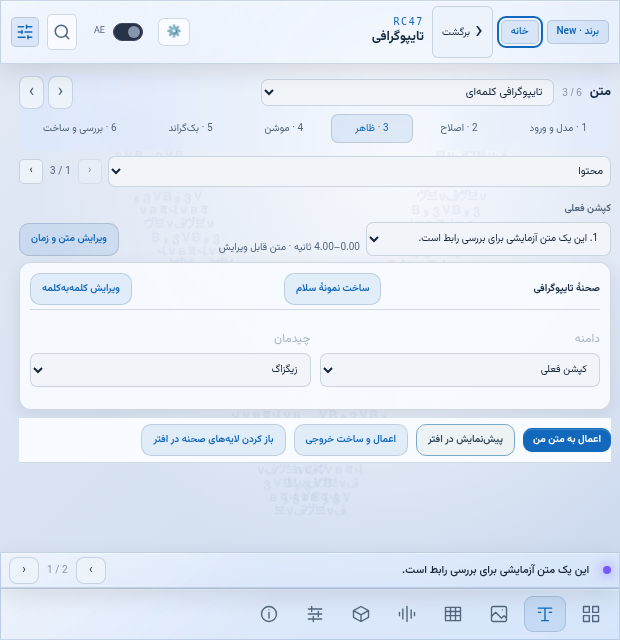
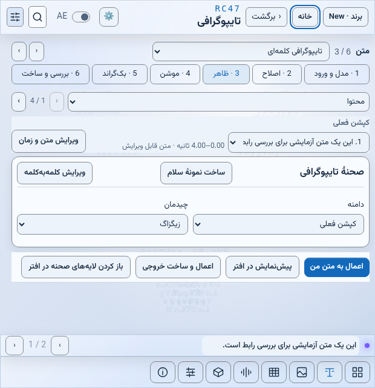

# مرحلهٔ A — مقایسهٔ قبل و بعد

فقط خوانایی و توکن‌های رابط افتر تغییر کرده است. چیدمان خانه، خروجی و محدودهٔ امن هنوز به مرحلهٔ B تعلق دارد.

[گزارش کامل مرحله](STAGE_A_FA.md) · [شناسه‌ها و مرز تغییر](contract.json) · [آمار مقایسه](comparison.json) · [خروجی آزمون‌ها](tests/) · [نمای مقایسهٔ محلی](compare.html)

۸۸ تصویر، ۲۲ صفحه، تم روشن و تیره، اندازهٔ یکسان ۶۲۰×۶۴۰؛ تصاویر مرورگرند، نه تایید اجرای واقعی افتر.

| صفحه | روشن: قبل | روشن: بعد | تیره: قبل | تیره: بعد |
|---|---|---|---|---|
| خانه | [تصویر](before/light/home.png) | [تصویر](after/light/home.png) | [تصویر](before/dark/home.png) | [تصویر](after/dark/home.png) |
| متن | [تصویر](before/light/text.png) | [تصویر](after/light/text.png) | [تصویر](before/dark/text.png) | [تصویر](after/dark/text.png) |
| جدول | [تصویر](before/light/table.png) | [تصویر](after/light/table.png) | [تصویر](before/dark/table.png) | [تصویر](after/dark/table.png) |
| موشن | [تصویر](before/light/motion.png) | [تصویر](after/light/motion.png) | [تصویر](before/dark/motion.png) | [تصویر](after/dark/motion.png) |
| تایپوگرافی کلمه‌ای | [تصویر](before/light/kinetic.png) | [تصویر](after/light/kinetic.png) | [تصویر](before/dark/kinetic.png) | [تصویر](after/dark/kinetic.png) |
| استایل‌ها | [تصویر](before/light/templates.png) | [تصویر](after/light/templates.png) | [تصویر](before/dark/templates.png) | [تصویر](after/dark/templates.png) |
| افکت صوتی | [تصویر](before/light/sfx.png) | [تصویر](after/light/sfx.png) | [تصویر](before/dark/sfx.png) | [تصویر](after/dark/sfx.png) |
| ساخت صدا | [تصویر](before/light/music.png) | [تصویر](after/light/music.png) | [تصویر](before/dark/music.png) | [تصویر](after/dark/music.png) |
| ساخت زیرنویس | [تصویر](before/light/audio.png) | [تصویر](after/light/audio.png) | [تصویر](before/dark/audio.png) | [تصویر](after/dark/audio.png) |
| اصلاح هوشمند | [تصویر](before/light/ai.png) | [تصویر](after/light/ai.png) | [تصویر](before/dark/ai.png) | [تصویر](after/dark/ai.png) |
| بکگراند | [تصویر](before/light/bg.png) | [تصویر](after/light/bg.png) | [تصویر](before/dark/bg.png) | [تصویر](after/dark/bg.png) |
| برند | [تصویر](before/light/brand.png) | [تصویر](after/light/brand.png) | [تصویر](before/dark/brand.png) | [تصویر](after/dark/brand.png) |
| دستیار پروژه | [تصویر](before/light/director.png) | [تصویر](after/light/director.png) | [تصویر](before/dark/director.png) | [تصویر](after/dark/director.png) |
| منحنی حرکت | [تصویر](before/light/easing49.png) | [تصویر](after/light/easing49.png) | [تصویر](before/dark/easing49.png) | [تصویر](after/dark/easing49.png) |
| دستیار اسکریپت | [تصویر](before/light/assistant49.png) | [تصویر](after/light/assistant49.png) | [تصویر](before/dark/assistant49.png) | [تصویر](after/dark/assistant49.png) |
| محدودهٔ امن | [تصویر](before/light/safe.png) | [تصویر](after/light/safe.png) | [تصویر](before/dark/safe.png) | [تصویر](after/dark/safe.png) |
| کلمات مهم | [تصویر](before/light/keywords.png) | [تصویر](after/light/keywords.png) | [تصویر](before/dark/keywords.png) | [تصویر](after/dark/keywords.png) |
| ترجمه | [تصویر](before/light/translate.png) | [تصویر](after/light/translate.png) | [تصویر](before/dark/translate.png) | [تصویر](after/dark/translate.png) |
| ابزارهای افزوده | [تصویر](before/light/tools.png) | [تصویر](after/light/tools.png) | [تصویر](before/dark/tools.png) | [تصویر](after/dark/tools.png) |
| منابع سیستم | [تصویر](before/light/resources.png) | [تصویر](after/light/resources.png) | [تصویر](before/dark/resources.png) | [تصویر](after/dark/resources.png) |
| خروجی | [تصویر](before/light/output.png) | [تصویر](after/light/output.png) | [تصویر](before/dark/output.png) | [تصویر](after/dark/output.png) |
| تنظیمات | [تصویر](before/light/settings.png) | [تصویر](after/light/settings.png) | [تصویر](before/dark/settings.png) | [تصویر](after/dark/settings.png) |

## نمونهٔ تم روشن: تایپوگرافی

قبل:

بعد:

دو آزمون الزامی بدون تغییر سبزند. ۸۹۹ ID ثابت در هر ورودی حفظ شده‌اند. دروازهٔ انتشار همان ۸۶/۱۰۰ با همان ۱۴ شکست قبلی است؛ مرحلهٔ رفع آن‌ها هنوز انجام نشده است.
