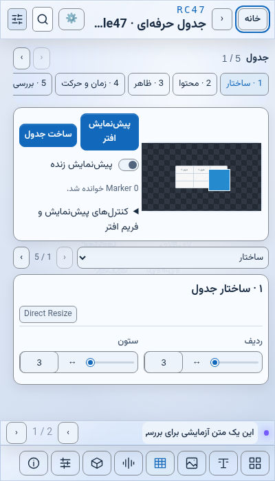
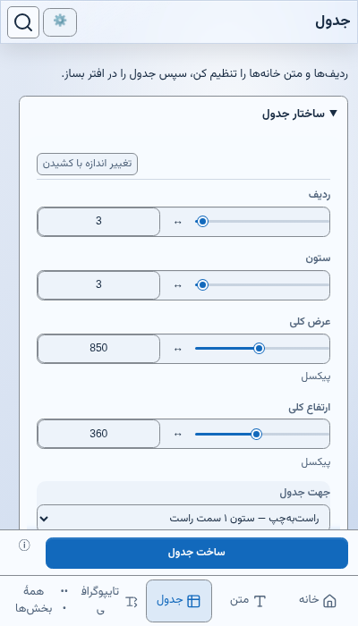
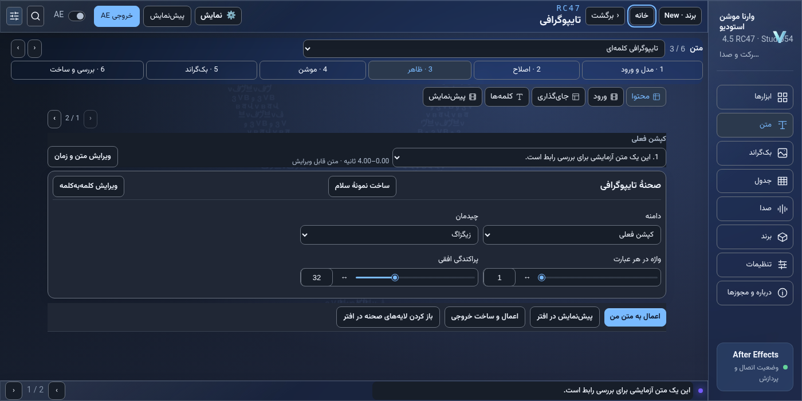
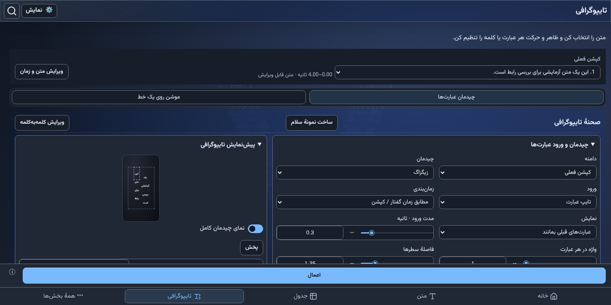

# بازبینی مرحلهٔ B — فقط جدول و تایپوگرافی

[گزارش و فایل‌های تغییرکرده](STAGE_B_PILOT_FA.md) · [نتیجهٔ تست‌ها](RESULTS.md) · [قرارداد ۸۹۹ شناسه](contract.json) · [کارهای باقی‌مانده](TODO.md)

۶۴ تصویر قبل/بعد، برای دو صفحه، چهار عرض و دو تم در فارسی و انگلیسی. ارتفاع همهٔ نمونه‌ها ۷۰۰ و مقیاس ۱۰۰٪ است. بزرگ‌نمایی‌ها و ارتفاع‌های دیگر در ماتریس خودکار بررسی می‌شوند.

فایل [compare.html](compare.html) را همراه تصاویر به‌صورت محلی باز کن تا صفحه، عرض، زبان و تم را انتخاب کنی. GitHub خودِ کد HTML را نشان می‌دهد؛ تصاویر زیر مستقیم باز می‌شوند.

## فارسی

| صفحه | عرض | تم | قبل | بعد |
|---|---:|---|---|---|
| جدول | 250 | روشن | [قبل](before/fa/light/table-250.png) | [بعد](after/fa/light/table-250.png) |
| جدول | 400 | روشن | [قبل](before/fa/light/table-400.png) | [بعد](after/fa/light/table-400.png) |
| جدول | 620 | روشن | [قبل](before/fa/light/table-620.png) | [بعد](after/fa/light/table-620.png) |
| جدول | 1400 | روشن | [قبل](before/fa/light/table-1400.png) | [بعد](after/fa/light/table-1400.png) |
| جدول | 250 | تیره | [قبل](before/fa/dark/table-250.png) | [بعد](after/fa/dark/table-250.png) |
| جدول | 400 | تیره | [قبل](before/fa/dark/table-400.png) | [بعد](after/fa/dark/table-400.png) |
| جدول | 620 | تیره | [قبل](before/fa/dark/table-620.png) | [بعد](after/fa/dark/table-620.png) |
| جدول | 1400 | تیره | [قبل](before/fa/dark/table-1400.png) | [بعد](after/fa/dark/table-1400.png) |
| تایپوگرافی | 250 | روشن | [قبل](before/fa/light/kinetic-250.png) | [بعد](after/fa/light/kinetic-250.png) |
| تایپوگرافی | 400 | روشن | [قبل](before/fa/light/kinetic-400.png) | [بعد](after/fa/light/kinetic-400.png) |
| تایپوگرافی | 620 | روشن | [قبل](before/fa/light/kinetic-620.png) | [بعد](after/fa/light/kinetic-620.png) |
| تایپوگرافی | 1400 | روشن | [قبل](before/fa/light/kinetic-1400.png) | [بعد](after/fa/light/kinetic-1400.png) |
| تایپوگرافی | 250 | تیره | [قبل](before/fa/dark/kinetic-250.png) | [بعد](after/fa/dark/kinetic-250.png) |
| تایپوگرافی | 400 | تیره | [قبل](before/fa/dark/kinetic-400.png) | [بعد](after/fa/dark/kinetic-400.png) |
| تایپوگرافی | 620 | تیره | [قبل](before/fa/dark/kinetic-620.png) | [بعد](after/fa/dark/kinetic-620.png) |
| تایپوگرافی | 1400 | تیره | [قبل](before/fa/dark/kinetic-1400.png) | [بعد](after/fa/dark/kinetic-1400.png) |

## English

| صفحه | عرض | تم | قبل | بعد |
|---|---:|---|---|---|
| جدول | 250 | روشن | [قبل](before/en/light/table-250.png) | [بعد](after/en/light/table-250.png) |
| جدول | 400 | روشن | [قبل](before/en/light/table-400.png) | [بعد](after/en/light/table-400.png) |
| جدول | 620 | روشن | [قبل](before/en/light/table-620.png) | [بعد](after/en/light/table-620.png) |
| جدول | 1400 | روشن | [قبل](before/en/light/table-1400.png) | [بعد](after/en/light/table-1400.png) |
| جدول | 250 | تیره | [قبل](before/en/dark/table-250.png) | [بعد](after/en/dark/table-250.png) |
| جدول | 400 | تیره | [قبل](before/en/dark/table-400.png) | [بعد](after/en/dark/table-400.png) |
| جدول | 620 | تیره | [قبل](before/en/dark/table-620.png) | [بعد](after/en/dark/table-620.png) |
| جدول | 1400 | تیره | [قبل](before/en/dark/table-1400.png) | [بعد](after/en/dark/table-1400.png) |
| تایپوگرافی | 250 | روشن | [قبل](before/en/light/kinetic-250.png) | [بعد](after/en/light/kinetic-250.png) |
| تایپوگرافی | 400 | روشن | [قبل](before/en/light/kinetic-400.png) | [بعد](after/en/light/kinetic-400.png) |
| تایپوگرافی | 620 | روشن | [قبل](before/en/light/kinetic-620.png) | [بعد](after/en/light/kinetic-620.png) |
| تایپوگرافی | 1400 | روشن | [قبل](before/en/light/kinetic-1400.png) | [بعد](after/en/light/kinetic-1400.png) |
| تایپوگرافی | 250 | تیره | [قبل](before/en/dark/kinetic-250.png) | [بعد](after/en/dark/kinetic-250.png) |
| تایپوگرافی | 400 | تیره | [قبل](before/en/dark/kinetic-400.png) | [بعد](after/en/dark/kinetic-400.png) |
| تایپوگرافی | 620 | تیره | [قبل](before/en/dark/kinetic-620.png) | [بعد](after/en/dark/kinetic-620.png) |
| تایپوگرافی | 1400 | تیره | [قبل](before/en/dark/kinetic-1400.png) | [بعد](after/en/dark/kinetic-1400.png) |

## نمونهٔ جدول در تم روشن، عرض ۴۰۰

قبل:

بعد:

## نمونهٔ تایپوگرافی در تم تیره، عرض ۱۴۰۰

قبل:

بعد:

