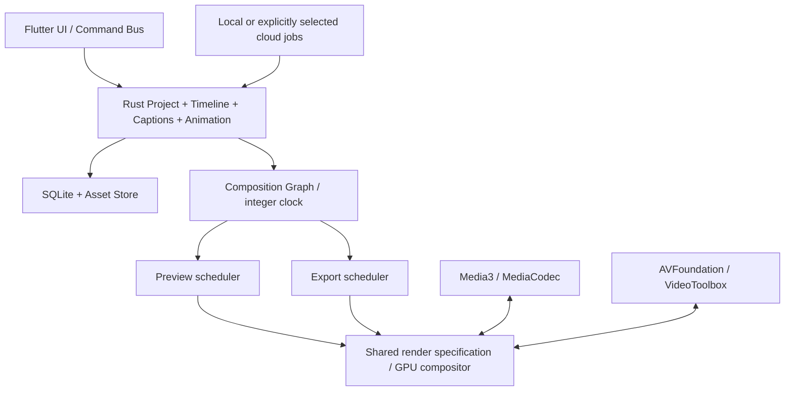

# سند اجرایی Varna Studio Mobile — بازنگری ۵۷

تاریخ: ۳۰ اکتبر ۲۰۲۶. دامنه: Android اول، iOS بعد. دستگاه اعلام‌شدهٔ کاربر: **Honor 90**؛ نسخهٔ Android/MagicOS و RAM هنوز مشخص نشده است. این سند، برنامهٔ توسعه و مرز امکانات تحویل‌شده را از هم جدا می‌کند.

فرض‌های اجرایی بر اساس پیشنهاد کاربر: محصول تجاری با رابط و برند اختصاصی، تعادل کیفیت/سرعت/سازگاری، هدف میان‌رده و پرچم‌دار، تدوین پایه آفلاین، AI ترکیبی با انتخاب صریح کاربر. این فرض‌ها قرارداد حقوقی یا تضمین پشتیبانی همهٔ گوشی‌ها نیستند.

## وضعیت قابل نصب امروز

Mobile57 یک ارتقای قابل نصب روی Mobile56 است: همان شناسهٔ اپ و همان کلید امضا، با versionCode بالاتر. فایل‌ها و پروژهٔ قبلی خوانده می‌شوند. رابط فعلی Java + WebView است؛ خروجی Android با MediaCodec/MediaMuxer اجرا می‌شود. Flutter، Rust، Media3، wgpu و مدل ASR **هنوز داخل APK نیستند**. ساختار پیشنهادی جدید با فهرست کتابخانه‌ها جایگزین یکبارهٔ امکانات فعال نشده است.

| بخش | اجراشده در ۰٫۲ | کار باقی‌مانده |
|---|---|---|
| تدوین | چند ترک، برش/تریم، جابه‌جایی، قفل، ترتیب ترک، انتقال کلیپ بین ترک‌های سازگار، Snap، Undo/Redo | ripple/slip/roll، سرعت متغیر، reverse، proxy، thumbnail cache |
| کپشن | SRT/WebVTT، ویرایش زمان هر واژه، karaoke، reveal، تک‌واژه، رنگ فعال، دورخط، فاصلهٔ خطوط، استایل قابل ذخیره | ASR/VAD/alignment واقعی، تشخیص گوینده، ترجمه، ASS/SSA کامل |
| موشن | کی‌فریم موقعیت/ابعاد/چرخش/شفافیت، منحنی‌های موجود، فهرست و حذف کلید، شکل و جدول شیشه‌ای | curve editor دیداری، transition graph، mask، motion blur و اثرهای GPU |
| صدا | میکس و فید موجود؛ موج واقعی محلی برای رسانهٔ حداکثر ۲۰ MiB و ۱۲۰ ثانیه | waveform بومی streaming برای فایل بزرگ، EQ، RNNoise، pitch، ducking و automation |
| پروژه | فایل `.varna` با clock صحیح، مهاجرت دادهٔ قدیمی، autosave با آخرین نسخهٔ معتبر پشتیبان | SQLite transaction/journal، چند پروژه، پوشهٔ رسانهٔ قابل حمل، proxy mapping |
| خروجی | compositor مشترک فعلی، MP4 بومی، PNG/SRT/VTT؛ ارسال ترتیبی و غیرهم‌زمان فریم | texture-to-encoder بدون PNG/Base64، 4K/HEVC/AV1 و ادامهٔ کار در پس‌زمینه پس از آزمون دستگاه |
| رابط | فارسی/انگلیسی، portrait/landscape، تم روشن/تاریک، مواد شیشه‌ای CSS | Flutter design system و دسترس‌پذیری native، gesture/animation parity |

اصلاح املای آفلاین همچنان کلید مستقل دارد، کنار متن است و هیچ اصلاح املایی یا فینگلیش را بدون تأیید اعمال نمی‌کند. این موتور با تشخیص گفتار متفاوت است. زمان توزیع‌شدهٔ کلمات در UI «تخمینی» نام‌گذاری شده؛ نتیجهٔ Whisper یا alignment ادعا نمی‌شود.

## معماری مقصد و دلیل مهاجرت مرحله‌ای

رابط Flutter، هستهٔ Rust و Media I/O بومی مقصد معماری‌اند. واحد مشترک، **قرارداد پروژه + Composition Graph + ساعت** است؛ خود Flutter یا یک پلیر مالک پروژه نیست. ابتدا قراردادهای فعال فعلی و آزمون‌های آن حفظ می‌شوند؛ سپس هر backend با خروجی قابل مقایسه جایگزین می‌شود. تا عبور آزمون‌ها، نام یک کتابخانه به معنی تکمیل آن موتور نیست.

wgpu انتخاب آزمایشی برای compositor مشترک است. اتصال frame/surfaceهای Media3 به wgpu و CVPixelBuffer/Metal در iOS باید **قبل از تثبیت** با مالکیت texture، color space، synchronization و تعداد copyها اندازه‌گیری شود. نصب هم‌زمان wgpu، Skia و Media3 بدون این قرارداد ممکن است سه مسیر رندر متفاوت و کند بسازد. تا نتیجهٔ این آزمایش، مسیر OpenGL اندروید و Metal آیفون adapters یک graph هستند؛ equivalence خروجی باید با فریم‌های مرجع سنجیده شود.

PNG/Base64 در نسخهٔ فعلی پل انتقال فریم است و مسیر نهایی مناسب 4K نیست. در Mobile57 انتظار برای encode به‌صورت asynchronous و با فقط یک فریم در حال پردازش انجام می‌شود؛ این تغییر پاسخ‌گویی UI را بهبود می‌دهد، ولی هزینهٔ PNG و تبدیل YUV را حذف نمی‌کند. کدک سخت‌افزاری به‌تنهایی به معنی compositor GPU نیست.

## مرز ماژول‌ها و قرارداد اجرایی

| مسیر فعال | مسئولیت | قرارداد جایگزین در مقصد |
|---|---|---|
| `web/engines/project57.js` | pack/unpack، clock، migration و recovery | `rust/project`؛ `load`, `applyCommand`, `saveSnapshot` |
| `web/engines/timeline57.js` | snap، قفل و ترتیب ترک | `rust/timeline`؛ عملیات frame-quantized با Undo command |
| `web/engines/captions57.js` | واژه، زمان‌بندی، retime/split، حالت نمایش و VTT | `rust/subtitles` و `rust/animation` |
| `web/mobile-core.js` + shared renderers | قواعد تصویر پروژه در preview/export | `rust/composition` + `native/*/renderer` |
| `web/engines/media-analysis57.js` | موج محدود و محلی | `native/android/audio`، `native/ios/audio`؛ streaming peaks |
| `web/mobile-tools57.js` | کنترل‌های ویرایش، مستقل از موتور کپشن | `apps/mobile/lib/features/captions` |
| `android/.../MainActivity.java` | فایل‌ها، پل درخواست/پاسخ و چرخهٔ عمر | Flutter platform channels / rust bridge |
| `VideoEncoder.java`, `AudioRenderer.java` | H.264/AAC و میکس روی clock پروژه | Media3/AVFoundation export adapters |

ساختار مقصد در شروع مهاجرت: `apps/mobile/lib/{features,design_system,core}`، `native/{android,ios}/{media,renderer,audio,ai}`، `rust/{project,timeline,composition,animation,subtitles,ffi}`، `ai/{local,task_manager}`، `backend/{api,workers,queue,storage}`، `shared/{schemas,localization}` و `tests/{rendering,performance,integration}`. پوشهٔ خالی یا wrapper بدون اتصال عملی جزو قابلیت تحویل‌شده محسوب نمی‌شود.

## پروژه و زمان

Schema واقعی در `../shared/varna-project-v1.schema.json` قرار دارد. فرمت `varna-project`، نسخهٔ ۱ و timebase برابر ۱/۷۲۰۰۰۰ ثانیه است؛ شروع، پایان، in/out، زمان واژه و keyframe با integer ticks ذخیره می‌شوند. `project.frameRate` یک rational است؛ **renderer فعلی فقط fps صحیح ۱۲ تا ۳۰** را قبول می‌کند. قرارداد rational، ادعای فعال‌بودن 29.97 نیست. آزمون ۱۰۰۰ بار رفت‌وبرگشت زمان‌ها را ثابت نگه می‌دارد.

فایل پروژه مالک رسانه نیست. assets شناسهٔ پایدار و metadata دارند؛ نقل‌وانتقال بین دستگاه‌ها به relink نیاز دارد. در مقصد asset store با content hash، proxyId جدا، relative URI و transaction مستقل ساخته می‌شود. هیچ cache یا URI موقت نباید تنها مرجع فایل اصلی باشد. نسخهٔ فعلی کپی رسانه را در app-private storage نگه می‌دارد؛ export/backup کاربر باید قبل از clear-data/uninstall انجام شود.

Autosave فعلی دو نسخهٔ معتبر دارد و از دادهٔ خراب به نسخهٔ قبل برمی‌گردد. این localStorage atomic write جای transaction پایدار SQLite را در مقصد نمی‌گیرد. هر تغییر تأییدشده یک history entry دارد؛ تولید waveform metadata به history ویرایش اضافه نمی‌شود.

## Caption Studio و AI ترکیبی

ورودی استاندارد ASR: mono PCM همراه sample rate، شناسهٔ رسانه و محدودهٔ source؛ خروجی: segments و words با start/end ticks، language، speaker اختیاری، confidence اختیاری و provenance شامل مدل/نسخه/alignment. زمان صوت مبنا باید به timeline با source in/start نگاشت شود؛ تقسیم مساوی جمله جای alignment نیست.

1. Android: آزمایش whisper.cpp مدل multilingual quantized روی Honor 90؛ معیار اول دقت فارسی و سرعت/حافظه است، نه فقط ساخته‌شدن library.
2. iOS: مقایسهٔ WhisperKit/Core ML با whisper.cpp روی همان corpus؛ فعال‌بودن diarization یا کیفیت فارسی باید برای نسخه/مدل انتخابی جدا ثابت شود.
3. VAD: مدل Silero با license و checksum ثبت‌شده؛ runtime ONNX فقط در صورت سود اندازه‌گیری‌شده به بسته اضافه شود.
4. Cloud: فقط با انتخاب روشن کاربر، endpoint مشخص و احراز هویت؛ نمایش اندازه/بازهٔ فایل پیش از upload. عدم وجود مدل محلی نباید باعث upload خودکار شود.
5. Job state: `queued → running → transferring → completed`، به‌علاوه `cancelled/failed/interrupted`؛ progress واقعی، cancellation token، idempotency key، retry تفکیک‌شده از submission و recovery پس از restart. این سرویس‌ها هنوز در ۰٫۲ فعال نیستند.

مدل‌ها همراه manifest جدا نصب می‌شوند: مدل/مجوز/hash/حداقل RAM/زبان‌ها/نسخهٔ runtime/محدودیت تجاری. برچسب MIT runtime مجوز همهٔ وزن‌ها یا Datasetها را تعیین نمی‌کند. فایل کاربر برای سنجش از پیش‌فرض اپ خارج نمی‌شود.

## انتخاب مخزن و نسخه

جدول دقیق منابع و pinها در `DEPENDENCIES57.md` و پاسخ‌ها/فایل مجوز در `upstream-audit57.json` ثبت شده‌اند. نتیجهٔ این بررسی با «اضافه‌شدن به APK» یکی نیست. Flutter GitHub Releases نسخهٔ قدیمی prerelease برمی‌گرداند؛ pin از stable tag انتخاب شد. دانلود manifest رسمی SDK در این محیط HTTP 403 گرفت؛ **Flutter build انجام نشده**. OpenTimelineIO از نشانی فعال AcademySoftwareFoundation بررسی شد؛ نشانی OpenTimelineIO/OpenTimelineIO پاسخ 404 داشت.

کد Kdenlive/Shotcut/VideoFreeStudio به اپ کپی نشده است. این مخزن‌ها برای مطالعهٔ رفتار تدوین مفیدند؛ مجوز محصول بسته با اضافه‌کردن کورکورانهٔ GPL/AGPL حل نمی‌شود. FFmpeg candidate با build configuration مشخص LGPL و فهرست codecها بررسی می‌شود؛ فعال‌کردن اجزای GPL یا nonfree جدا تصمیم‌گیری می‌شود. Rubber Band/JUCE/Remotion پیش‌فرض این محصول نیستند و بدون بررسی شرایط نسخه/مجوز وارد باینری نمی‌شوند. font، dictionary، مدل و runtime هرکدام notice مستقل دارند.

## گیت‌های توسعهٔ بعدی

| مرحله | خروجی قابل قبول | شرط عبور |
|---|---|---|
| Flutter + Rust foundation | بازکردن همان `.varna` و اعمال همان commandها | migration و Undo/Redo parity؛ فایل قدیمی حفظ شود |
| Native media prototype | دو ویدیو + متن فارسی + جدول + صدا در preview و MP4 | frame parity، A/V sync، cancel/retry روی Honor 90 |
| Caption AI | مدل محلی با انتخاب/دانلود قابل مدیریت و واژه‌های زمان‌دار | corpus فارسی/انگلیسی، خطای زمان و واژه، RAM/RTF ثبت شود |
| Motion/audio | effect graph، transitions، waveform بومی، automation | همان پارامترها در preview/export؛ timing regression |
| iOS | app build و همان fixture روی iPhone | macOS/Xcode، signing و آزمون دستگاه مستقل |
| محصول عمومی | کدک/رزولوشن‌های advertise شده روی device matrix | export طولانی، recovery، storage full، thermal و migration |

## آزمون Honor 90

Android/MagicOS، RAM، WebView و فضای آزاد ثبت شوند. ابتدا پروژهٔ ۳۰ ثانیه‌ای 1080p با دو ویدیو، دو ترک صدا، کپشن فارسی/انگلیسی و جدول اجرا شود. جداگانه زمان decode/render/encode، p50/p95 زمان فریم، frame drops، RAM peak، دمای دستگاه و A/V offset اندازه‌گیری شوند. هدف ۳۰ fps، صفر crash و اختلاف کم preview/export هدف مهندسی است؛ **روی Honor 90 هنوز اندازه‌گیری نشده است**.

کلیپ تست شامل عدد فارسی، نیم‌فاصله، لاتین و emoji، حروف متصل، کلمهٔ بلند و چند خط باشد. در خروجی از همان timestampها فریم استخراج و با preview مقایسه شود؛ lossy encoding و اختلاف text shaping جدا گزارش شوند. برای محصول بعدی 4K/HEVC/AV1 فقط وقتی اعلام می‌شوند که codec capabilities و آزمون همان دستگاه اجازه دهند.

CUDA/NVENC مربوط به گزینهٔ پردازش دسکتاپ/سرور NVIDIA است؛ شرط اجرای Honor 90 یا اپ موبایل نیست. شتاب‌دهی موبایل از codec و GPU/providerهای واقعاً موجود روی دستگاه انتخاب می‌شود.
